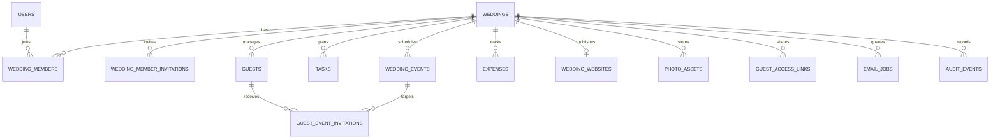

# Indian Wedding Management Platform — Database Design

**Document type:** Database Design Specification  
**Status:** Draft — implementation baseline  
**Last updated:** October 18, 2026  
**Database:** MongoDB Atlas · **ODM:** Mongoose · **Boundary validation:** Zod

---

## 1. Purpose and scope

This document defines the initial persistence model for the Indian Wedding Management Platform. It translates the system architecture into collections, fields, relationships, indexes, tenant-isolation rules, and important concurrency workflows.

A wedding is a workspace. A user may belong to multiple weddings, while guests do not need accounts. Every wedding-scoped operation must verify both the target `weddingId` and the acting user's membership/role. The MVP is a modular monolith using Next.js/TypeScript, MongoDB Atlas and Mongoose, Clerk for team authentication, Ably for notifications, Cloudflare R2 for photo objects, Resend for email, and Vercel Cron for small-batch durable jobs.

## 2. Database decisions

- **References:** use MongoDB `ObjectId` references for separately managed entities. Embed only small bounded value objects that are generally read/updated with their parent.
- **Tenant boundary:** every wedding-owned document includes `weddingId`, even where another relationship could infer the wedding.
- **Identity:** Clerk authenticates team users; MongoDB stores a minimal local `User` profile with a unique `clerkUserId`. Internal references use `User._id`.
- **Guests:** no guest accounts. Guest actions use scoped bearer links, validated server-side.
- **Dates:** BSON `Date` timestamps in UTC, with an IANA timezone string (for example `Asia/Kolkata`) stored separately for local display/scheduling.
- **Money:** store integer minor units plus an ISO currency code. For INR, ₹1,250.00 is `{ amountMinor: 125000, currency: "INR" }`.
- **Photos:** store R2 object keys and metadata only, never image binaries or permanent public URLs in MongoDB.
- **Secrets:** save hashes of invitation/access tokens, never raw bearer tokens.
- **Validation:** Zod checks untrusted input; Mongoose checks persisted document shape; domain services enforce relationships and permissions.
- **Schema evolution:** prefer backward-compatible changes; use repeatable migrations for renames, enum changes, and backfills.

## 3. Collection overview

### Core MVP collections

| Collection | Purpose | Scope |
|---|---|---|
| `users` | Local profile for Clerk-authenticated team member | Global |
| `weddings` | Workspace settings and ownership root | Root |
| `weddingMembers` | Membership and role for each workspace | Wedding |
| `weddingMemberInvitations` | Invite organizer/team members | Wedding |
| `weddingEvents` | Functions, dates, venue and livestream URL | Wedding |
| `tasks` | Planning tasks and assignments | Wedding |
| `guests` | One document per individual guest | Wedding |
| `guestEventInvitations` | Per-guest, per-event invitation and RSVP | Wedding |
| `expenses` | Budget and spending items | Wedding |
| `weddingWebsites` | Separate public-facing page configuration | Wedding |
| `photoAssets` | Photo metadata and R2 object reference | Wedding |
| `guestAccessLinks` | Revocable, scoped gallery access links | Wedding |
| `emailJobs` | Durable delivery/retry records | Optional wedding scope |
| `auditEvents` | Important business/security actions | Optional wedding scope |

### Optional later collections

| Collection | Purpose | Add when |
|---|---|---|
| `vendors` | Caterers, photographers, decorators, etc. | Vendor directory is confirmed scope |
| `vendorBookings` | Vendor assignments, quotes, contracts and payments | Booking workflow is required |
| `budgetCategories` | Custom category configuration and limits | Embedded/default categories are insufficient |
| `photoAlbums` | Named gallery groupings with separate permissions | Users need independently shared albums |

Venue lookup can be represented by a compact value object on `weddingEvents` in the MVP. Store Google Place IDs/details only to the extent allowed by Google Places terms; manual venue entry must remain available.

## 4. Entity relationship overview



MongoDB does not enforce these reference relationships automatically. Services must verify that all referenced documents exist and belong to the same wedding. Use transactions where multi-document atomicity is required and supported by the Atlas deployment.

## 5. Common conventions

A typical wedding-scoped document uses a subset of the following fields:

```ts
{
  _id: ObjectId,
  weddingId: ObjectId,
  createdAt: Date,
  updatedAt: Date,
  createdByUserId: ObjectId,
  updatedByUserId?: ObjectId,
  archivedAt?: Date | null
}
```

- Collection names and field names follow the names used in this document.
- `clerkUserId` is an external string, not an ObjectId.
- Normalize searchable email/phone values while preserving display values where needed.
- Use enums shared between TypeScript constants, Zod and Mongoose.
- Avoid empty-string placeholders and unbounded arrays.
- Do not store derived totals unless there is a measured performance reason and a reliable reconciliation path.

## 6. Collection specifications

### 6.1 `users` — Core

One local profile per Clerk user. Do not copy passwords or authentication credentials into MongoDB.

| Field | Type | Notes |
|---|---|---|
| `_id` | ObjectId | Internal user ID |
| `clerkUserId` | string | Required external ID; unique |
| `displayName` | string | Optional display name |
| `email` / `emailNormalized` | string | Optional, if provided by Clerk |
| `avatarUrl` | string | Optional profile image URL |
| `createdAt`, `updatedAt` | Date | Timestamps |
| `lastSeenAt` | Date | Optional; update sparingly |

**Indexes:** unique `{ clerkUserId: 1 }`; optional non-unique `{ emailNormalized: 1 }` only if email lookup is needed.

**Rules:** create/upsert only after validating the Clerk session/token. Email verification is intentionally not required in v1, so never treat the email string alone as proof of mailbox ownership.

### 6.2 `weddings` — Core

The root workspace document.

```ts
{
  _id: ObjectId,
  name: string,
  slug?: string,
  status: "active" | "archived",
  eventDateStart?: Date,
  eventDateEnd?: Date,
  timezone: string,                  // IANA timezone
  defaultCurrency: "INR",            // store as ISO currency code
  createdByUserId: ObjectId,
  settings: {
    defaultWebsiteVisibility: "private" | "public",
    guestLinksDefaultExpiryDays: number,
    allowGuestPhotoDownloads: boolean
  },
  budgetTargetMinor?: number,
  createdAt: Date,
  updatedAt: Date,
  archivedAt?: Date | null
}
```

**Indexes:** `{ status: 1, updatedAt: -1 }` if needed for workspace listing; unique partial `{ slug: 1 }` if the slug is global and present.

**Rules:** create the wedding and initial owner membership as one logical operation. Treat the currency as a default, not a guarantee that all expenses use the same currency. Prefer archive/export/delete lifecycle workflows to immediate hard deletion.

### 6.3 `weddingMembers` — Core

Membership is the authorization link between users and workspaces.

```ts
{
  _id: ObjectId,
  weddingId: ObjectId,
  userId: ObjectId,
  role: "owner" | "admin" | "planner" | "viewer",
  status: "active" | "suspended" | "removed",
  invitedByUserId?: ObjectId,
  joinedAt: Date,
  createdAt: Date,
  updatedAt: Date
}
```

**Indexes:** unique `{ weddingId: 1, userId: 1 }`; `{ userId: 1, status: 1 }`; `{ weddingId: 1, role: 1, status: 1 }` when useful.

**Rules:** every request checks active membership and the role's permission. The permission matrix must live in a central authorization module. Prevent removal/demotion of the last active owner. Role changes or removal may also require cache/session and Ably subscription invalidation.

### 6.4 `weddingMemberInvitations` — Core

Team invitations are separate from guest invitations.

```ts
{
  _id: ObjectId,
  weddingId: ObjectId,
  email: string,
  emailNormalized: string,
  role: "admin" | "planner" | "viewer",
  tokenHash: string,
  status: "pending" | "accepted" | "revoked" | "expired",
  invitedByUserId: ObjectId,
  expiresAt: Date,
  acceptedByUserId?: ObjectId,
  acceptedAt?: Date,
  revokedAt?: Date,
  createdAt: Date,
  updatedAt: Date
}
```

**Indexes:** unique `{ tokenHash: 1 }`; `{ weddingId: 1, emailNormalized: 1, status: 1 }`; `{ status: 1, expiresAt: 1 }` for expiry maintenance.

**Rules:** generate a high-entropy random token, send it once, and store only its hash. Verify status and expiry on acceptance; tokens are one-time-use and revocable. Since email verification is off in v1, the acceptance flow must clearly identify the invited wedding/role and follow an explicit account identity policy. Avoid relying on a TTL index as the only expiry check; expiry must be enforced in application logic and records may be retained for audit/debugging.

### 6.5 `weddingEvents` — Core

A wedding may have multiple functions (mehendi, haldi, sangeet, wedding, reception, etc.).

```ts
{
  _id: ObjectId,
  weddingId: ObjectId,
  name: string,
  eventType?: string,
  description?: string,
  startAt: Date,
  endAt?: Date,
  timezone: string,
  venue?: {
    name?: string,
    addressText?: string,
    placeId?: string,
    latitude?: number,
    longitude?: number,
    directionsUrl?: string,
    source: "google_places" | "manual"
  },
  livestream?: { provider: "youtube", url: string, videoId?: string },
  status: "draft" | "published" | "cancelled",
  sortOrder: number,
  createdByUserId: ObjectId,
  createdAt: Date,
  updatedAt: Date,
  archivedAt?: Date | null
}
```

**Indexes:** `{ weddingId: 1, startAt: 1 }`; `{ weddingId: 1, status: 1, startAt: 1 }`.

**Rules:** validate `endAt >= startAt`, timezone, coordinate bounds, directions URL, and YouTube URL/video identifier. Never store arbitrary iframe HTML. Store only Google Places data permitted by provider terms and offer manual entry. Query by both event ID and wedding ID.

### 6.6 `tasks` — Core

```ts
{
  _id: ObjectId,
  weddingId: ObjectId,
  title: string,
  description?: string,
  status: "todo" | "in_progress" | "blocked" | "done" | "cancelled",
  priority: "low" | "normal" | "high" | "urgent",
  dueAt?: Date,
  assigneeMemberIds: ObjectId[],
  relatedEventId?: ObjectId,
  completedAt?: Date,
  createdByUserId: ObjectId,
  createdAt: Date,
  updatedAt: Date,
  archivedAt?: Date | null
}
```

**Indexes:** `{ weddingId: 1, status: 1, dueAt: 1 }`; `{ weddingId: 1, assigneeMemberIds: 1, status: 1 }`; optional `{ weddingId: 1, relatedEventId: 1 }`.

**Rules:** cap the number of assignees, validate each assignee is an active member of this wedding, and validate `relatedEventId` belongs to the wedding. Store long task activity/comments in separate documents if introduced; do not grow one task document indefinitely.

### 6.7 `guests` — Core

One document per individual guest. A guest can be invited to multiple wedding functions.

```ts
{
  _id: ObjectId,
  weddingId: ObjectId,
  firstName: string,
  lastName?: string,
  displayName: string,
  email?: string,
  emailNormalized?: string,
  phone?: string,
  phoneNormalized?: string,
  householdLabel?: string,
  notes?: string,
  tags: string[],
  source: "manual" | "csv_import",
  createdByUserId: ObjectId,
  createdAt: Date,
  updatedAt: Date,
  archivedAt?: Date | null
}
```

**Indexes:** `{ weddingId: 1, displayName: 1 }`; optional non-unique `{ weddingId: 1, emailNormalized: 1 }` and `{ weddingId: 1, phoneNormalized: 1 }`.

**Rules:** email and phone must not be unique by default because family members may share contact details. Provide CSV import preview and duplicate warnings. Normalize contacts for matching; preserve display values. Limit import size and restrict guest notes to authorized members; never log notes or full guest records.

### 6.8 `guestEventInvitations` — Core

One record per guest per event. A guest invited to three functions has three documents. **A missing record means the guest was not invited to that event.**

```ts
{
  _id: ObjectId,
  weddingId: ObjectId,
  guestId: ObjectId,
  eventId: ObjectId,
  invitationStatus: "draft" | "ready" | "sent" | "cancelled",
  rsvpStatus: "pending" | "accepted" | "declined",
  invitedAt?: Date,
  respondedAt?: Date,
  responseChannel?: "guest_link" | "organizer" | "import",
  partySize?: number,
  dietaryNotes?: string,
  accessLinkId?: ObjectId,
  createdByUserId: ObjectId,
  createdAt: Date,
  updatedAt: Date
}
```

**Indexes:** unique `{ weddingId: 1, guestId: 1, eventId: 1 }`; `{ weddingId: 1, eventId: 1, rsvpStatus: 1 }`; `{ weddingId: 1, guestId: 1 }`; `{ weddingId: 1, invitationStatus: 1, updatedAt: -1 }`.

**Rules:** confirm the guest and event belong to the same wedding. The compound unique index prevents duplicate invitation/RSVP rows. `not invited` is represented by no row, not a persisted RSVP status. A guest's RSVP endpoint may update only allowed fields for the exact invitation resolved by a validated token; never trust client-supplied guest/event/wedding IDs. Decide response-change deadlines and plus-one policy before launch.

### 6.9 `expenses` — Core

```ts
{
  _id: ObjectId,
  weddingId: ObjectId,
  title: string,
  category: string,
  status: "estimated" | "committed" | "paid" | "cancelled",
  amountMinor: number,
  currency: string,
  vendorId?: ObjectId,
  relatedEventId?: ObjectId,
  dueAt?: Date,
  paidAt?: Date,
  paymentMethod?: string,
  notes?: string,
  receiptObjectKey?: string,
  createdByUserId: ObjectId,
  createdAt: Date,
  updatedAt: Date,
  archivedAt?: Date | null
}
```

**Indexes:** `{ weddingId: 1, status: 1, dueAt: 1 }`; `{ weddingId: 1, category: 1, status: 1 }`; optional `{ weddingId: 1, relatedEventId: 1 }`.

**Rules:** `amountMinor` is a non-negative safe integer; reject decimals/floats at the API boundary and convert from user input to minor units. Store currency per expense. Validate event/vendor references against the same wedding. Compute totals from source records or maintain aggregates with reliable reconciliation; the client never supplies the authoritative total. Receipt objects are private.

### 6.10 `weddingWebsites` — Core

Separate public content from guest lists, budgets, planning notes and other internal data.

```ts
{
  _id: ObjectId,
  weddingId: ObjectId,
  slug: string,
  visibility: "private" | "public",
  status: "draft" | "published" | "unpublished",
  title: string,
  welcomeMessage?: string,
  story?: string,
  heroImageAssetId?: ObjectId,
  scheduleEventIds: ObjectId[],
  livestreamEventIds: ObjectId[],
  theme?: { themeKey?: string, primaryColor?: string, accentColor?: string },
  publishedAt?: Date,
  createdByUserId: ObjectId,
  createdAt: Date,
  updatedAt: Date
}
```

**Indexes:** unique `{ weddingId: 1 }` (one site per wedding); unique partial `{ slug: 1 }` where slug exists.

**Rules:** public routes must return a purpose-built allowlisted DTO, not a raw Mongo document. Verify referenced events/assets belong to the same wedding and satisfy publication rules. Normalize slugs, reserve system routes, and explicitly define whether the default is private.

### 6.11 `photoAssets` — Core

Photo metadata only; original bytes live in Cloudflare R2.

```ts
{
  _id: ObjectId,
  weddingId: ObjectId,
  eventId?: ObjectId,
  uploadedByUserId: ObjectId,
  r2ObjectKey: string,
  originalFileName?: string,
  contentType: "image/jpeg" | "image/png" | "image/webp" | "image/heic",
  sizeBytes: number,
  width?: number,
  height?: number,
  checksumSha256?: string,
  caption?: string,
  takenAt?: Date,
  status: "processing" | "available" | "quarantined" | "deleted",
  visibility: "private" | "public_website",
  createdAt: Date,
  updatedAt: Date,
  deletedAt?: Date | null
}
```

**Indexes:** `{ weddingId: 1, status: 1, createdAt: -1 }`; `{ weddingId: 1, eventId: 1, status: 1, createdAt: -1 }`; unique `{ r2ObjectKey: 1 }` if object keys are globally unique.

**Rules:** only authorized organizers can upload; guest links are read/download only. Never trust browser file extensions/content types. Enforce file limits and validate file contents. Use random object keys and never persist R2 credentials or long-lived signed URLs. Validate the event belongs to the same wedding. Coordinate DB deletion with R2 deletion and cache invalidation.

### 6.12 `guestAccessLinks` — Core

Scoped and revocable bearer links for gallery viewing/downloading. These are different from organizer team invitation tokens.

```ts
{
  _id: ObjectId,
  weddingId: ObjectId,
  tokenHash: string,
  scopeType: "wedding_gallery" | "event_gallery" | "asset",
  scopeId?: ObjectId,
  permissions: ("view" | "download")[],
  status: "active" | "revoked" | "expired",
  expiresAt: Date,
  maxUses?: number,
  useCount: number,
  createdByUserId: ObjectId,
  createdAt: Date,
  updatedAt: Date,
  revokedAt?: Date,
  lastUsedAt?: Date
}
```

**Indexes:** unique `{ tokenHash: 1 }`; `{ weddingId: 1, status: 1, expiresAt: 1 }`; optional `{ weddingId: 1, scopeType: 1, scopeId: 1, status: 1 }`.

**Rules:** use high-entropy tokens and store only their hash. Check status, expiry, permissions, usage limits and exact target scope on every request. Increment limited-use counters atomically. Before delivery, verify that the photo belongs to the wedding and falls within the link scope. Use short-lived media access or an authorized proxy; ensure CDN/transformation URLs cannot bypass access checks. Never log raw tokens, full private links, or signed URLs. Default expiry and whether links are per guest or reusable remain product decisions.

### 6.13 `emailJobs` — Core

One durable job per recipient/message for Resend delivery via small-batch Vercel Cron runs.

```ts
{
  _id: ObjectId,
  weddingId?: ObjectId,
  jobType: "team_invitation" | "guest_invitation" | "general",
  templateKey: string,
  recipientEmail: string,
  recipientEmailNormalized: string,
  referenceType?: "weddingMemberInvitation" | "guestEventInvitation",
  referenceId?: ObjectId,
  dedupeKey: string,
  status: "queued" | "processing" | "sent" | "retry_wait" | "failed" | "cancelled",
  attemptCount: number,
  nextAttemptAt: Date,
  leaseOwner?: string,
  leaseExpiresAt?: Date,
  providerMessageId?: string,
  lastErrorCode?: string,
  lastErrorAt?: Date,
  sentAt?: Date,
  createdAt: Date,
  updatedAt: Date
}
```

**Indexes:** unique `{ dedupeKey: 1 }`; `{ status: 1, nextAttemptAt: 1, createdAt: 1 }`; `{ status: 1, leaseExpiresAt: 1 }`; optional `{ weddingId: 1, createdAt: -1 }`.

**Rules:** claim a bounded batch atomically with a lease; do not use read-then-update alone. Use stable dedupe keys, retries with exponential backoff and jitter, and a maximum retry count. Record provider IDs and outcomes. Delivery is at-least-once: a timeout can happen after provider acceptance, so reconcile uncertain outcomes instead of retrying forever. Generate emails from controlled templates and minimize sensitive data stored in job records. Finalize consent/opt-out rules before production.

### 6.14 `auditEvents` — Core

Append-only records of important security or business actions.

```ts
{
  _id: ObjectId,
  weddingId?: ObjectId,
  actorUserId?: ObjectId,
  actorType: "user" | "system" | "guest_link",
  action: string,
  targetType?: string,
  targetId?: ObjectId,
  outcome: "success" | "denied" | "failure",
  requestId?: string,
  metadata?: Record<string, string | number | boolean | null>,
  createdAt: Date
}
```

**Indexes:** `{ weddingId: 1, createdAt: -1 }`; `{ actorUserId: 1, createdAt: -1 }`; `{ action: 1, createdAt: -1 }`.

**Rules:** append only. Store an allowlist of metadata and never log tokens, signed URLs, auth cookies or sensitive guest notes. Define retention and audit access before production.

## 7. Optional later schemas

### `vendors` — Later

Suggested fields: `_id`, `weddingId`, `name`, `category`, `contactName`, `email`, `phone`, `website`, `addressText`, permitted `googlePlaceId`, `notes`, `status`, timestamps, `createdByUserId`. Suggested index: `{ weddingId: 1, category: 1, name: 1 }`.

### `vendorBookings` — Later

Suggested fields: `_id`, `weddingId`, `vendorId`, `eventIds`, `serviceDescription`, `status`, `quotedAmountMinor`, `finalAmountMinor`, `currency`, deposit/balance due and paid dates, private `contractObjectKey`, timestamps and creator ID. Validate vendor/events belong to the same wedding.

### `photoAlbums` — Later

Add only when named albums need independent permissions. Prefer `albumId` on photo assets over an unbounded array of every asset ID in the album.

## 8. Index and query design

| Query pattern | Suggested index |
|---|---|
| List user's active weddings | `weddingMembers: { userId: 1, status: 1 }` |
| Check membership in a wedding | unique `weddingMembers: { weddingId: 1, userId: 1 }` |
| List events chronologically | `weddingEvents: { weddingId: 1, startAt: 1 }` |
| List open tasks by due date | `tasks: { weddingId: 1, status: 1, dueAt: 1 }` |
| Search/list guests by display name | `guests: { weddingId: 1, displayName: 1 }` |
| RSVP list/count by event | `guestEventInvitations: { weddingId: 1, eventId: 1, rsvpStatus: 1 }` |
| Prevent duplicate guest-event invitation | unique `{ weddingId: 1, guestId: 1, eventId: 1 }` |
| Expenses by category/status | `expenses: { weddingId: 1, category: 1, status: 1 }` |
| Recent photos by event | `photoAssets: { weddingId: 1, eventId: 1, status: 1, createdAt: -1 }` |
| Claim email jobs | `emailJobs: { status: 1, nextAttemptAt: 1, createdAt: 1 }` |
| Validate a bearer token | unique token-hash index on that token collection |

Use projections to return only necessary fields. Paginate lists, use cursor pagination for large photo/guest lists, cap user-supplied `$in` filters and batch sizes. Define indexes in Mongoose but create/modify production indexes with a controlled migration process. Detect duplicates before adding unique indexes; verify important queries with `explain()`.

## 9. Tenant isolation and authorization invariants

Every route, server action and background job must:

1. Authenticate the actor (Clerk for team users; validated scoped token for guests).
2. Resolve the internal `userId` for a team user.
3. Verify active membership in the requested wedding and permission for the operation.
4. Query/mutate wedding-scoped resources using both the resource ID and `weddingId`.
5. Validate every referenced event, guest, asset, vendor or member belongs to that wedding.
6. Use a field allowlist for writes; do not spread request bodies into MongoDB updates.
7. Return purpose-built DTOs rather than raw Mongoose documents.
8. Repeat all checks on the server even when the UI hides controls.

**Unsafe**

```ts
await WeddingEvent.findById(eventId); // no tenant constraint
```

**Safer, after membership/permission checks**

```ts
await WeddingEvent.findOne({ _id: eventId, weddingId });
```

Never trust a client-provided `weddingId` by itself. Bind the requested workspace to authenticated context and verify membership. For guests, derive the exact allowed wedding/scope from the token record rather than arbitrary request parameters.

## 10. Key workflows and concurrency

### 10.1 Create a wedding

1. Validate Clerk identity and request fields.
2. Insert the wedding.
3. Insert active owner membership.
4. Return the workspace after both writes succeed.

Prefer a transaction. If transactions are unavailable, build a recoverable workflow and never treat a workspace without an owner as ready for use.

### 10.2 Accept a team invitation

1. Hash presented token and find by `tokenHash`.
2. Check `status === "pending"` and `expiresAt > now`.
3. Apply the account identity policy (email verification is off in v1).
4. Mark accepted and upsert membership using the unique `{ weddingId, userId }` key.
5. Handle concurrent acceptance safely: re-read and return an idempotent result or reject an already-used token.

Use a transaction where practical. Never expose the stored hash or reuse an accepted token.

### 10.3 Create a guest invitation

1. Verify guest and event belong to the same wedding.
2. Upsert `guestEventInvitations` by its unique guest-event key.
3. Create a separate guest-link token only if required by the invitation/gallery workflow.
4. Add an email job with a stable `dedupeKey` for email delivery.
5. For WhatsApp sharing, generate a URL for an organizer to send manually unless a WhatsApp Business integration is explicitly implemented.
6. Record delivery state without putting raw credentials in logs.

Invitation state and delivery state are separate: a guest-event invitation can exist even if an email has not been delivered.

### 10.4 RSVP

1. Validate guest token and resolve the exact invitation record.
2. Check expiry/revocation and any RSVP deadline.
3. Conditionally update permitted fields only.
4. Set `respondedAt` and `responseChannel`.
5. Record an audit event if policy requires it.
6. Return a minimal confirmation, not guest-list data.

### 10.5 Upload and serve photos

1. Check organizer membership and upload permission.
2. Validate size, type, actual image format and event/wedding scope.
3. Issue a narrowly scoped upload capability or use a controlled backend upload.
4. Store object in R2 under a random key.
5. Create metadata and mark available only after successful validation/processing.
6. Reconcile/delete orphaned R2 objects if metadata creation fails.
7. For reads/downloads, authorize organizer or guest link and exact asset scope before issuing short-lived access.

### 10.6 Process email jobs

1. Find due jobs.
2. Atomically claim a bounded batch with `status: processing`, `leaseOwner` and `leaseExpiresAt`.
3. Send through Resend using idempotency where supported.
4. Store provider ID and success time.
5. Retry transient errors with bounded exponential backoff and jitter.
6. Move exhausted/permanent failures to `failed`; recover jobs whose leases expire.
7. Make overlapping cron runs safe.

Exactly-once delivery cannot be guaranteed across a network timeout. The goal is durable, observable, deduplicated, at-least-once processing.

## 11. Validation guidance

Use Zod for request inputs, environment variables, URLs and data arriving from CSV/third-party APIs. Use Mongoose for persisted shape, types, required fields, enums and basic constraints. Neither layer replaces authorization/domain checks.

- Validate MongoDB IDs before querying.
- Validate event date ordering and IANA timezones.
- Validate latitude (−90 to 90), longitude (−180 to 180), directions URLs and YouTube URLs.
- Validate money as a non-negative integer in minor units and currency as a supported ISO code.
- Validate content type, file size and actual uploaded file contents.
- Validate link status, expiry and transition rules together.
- Validate all references by both ID and `weddingId`.
- Use conditional updates/version checks on conflict-prone state transitions.
- Consider MongoDB JSON Schema validation for high-value collections after application schemas stabilize.

## 12. Privacy, retention and deletion

Guest records contain personal information; notes, dietary data, RSVPs and photos may be sensitive.

- Collect only what is required for planning and communication.
- Keep guest data private to authorized wedding members; public site DTOs must not expose guest lists, contacts, budgets or notes.
- Never log bearer tokens, signed URLs, auth cookies or full request bodies with personal data.
- Define retention for audit events, delivery jobs, expired links and deleted photos.
- Design wedding export/deletion across MongoDB records, R2 originals, transformations/cache and retained audit/delivery records.
- Configure Atlas backups and test a restore. Apply least-privilege DB credentials by environment and keep secrets out of source control.
- Prefer stable internal IDs and request IDs in logs over full guest records.

Soft delete/archive is the default until the retention and legal requirements are defined. Deletion is a workflow across collections and object storage, not a single document delete.

## 13. Operational recommendations

- Use a dedicated Atlas application user with least privilege.
- Configure connection pooling for Vercel/serverless runtime and reuse a cached Mongoose connection per warm runtime.
- Keep work bounded: paginate lists, cap imports and batch sizes, and avoid unbounded arrays.
- Monitor Atlas storage, connections, slow queries, index usage and backup health.
- Use structured Vercel logs with request ID, safe internal IDs, action, duration and outcome; exclude secrets and unnecessary PII.
- Rate-limit invite creation/acceptance, RSVP, upload initiation, email-job creation and Places lookups using shared/distributed enforcement rather than in-memory process state.
- Configure external-service budget alerts for email, storage/CDN and Places API.
- MongoDB remains the source of truth. Ably events notify connected clients but are not the durable record of a business operation.

## 14. Migration and rollout plan

1. Implement shared TypeScript IDs/enums and Zod schemas for statuses, money, dates and URLs.
2. Implement Mongoose schemas and initial indexes.
3. Build centralized membership/permission helpers before feature routes.
4. Create fixtures for two weddings and test cross-wedding access denial.
5. Test unique-index conflicts and concurrent operations: duplicate invitations, RSVP updates, invite acceptance and email-job claiming.
6. Add repeatable index/migration scripts for staging and production.
7. Use only non-sensitive demo data in development.
8. Verify backups, restore steps, retention and R2 orphan cleanup before production.

Include API/integration tests that try to read wedding A data while authenticated only for wedding B; unit tests alone are insufficient.

## 15. Minimum test matrix

| Scenario | Expected result |
|---|---|
| User without membership requests wedding data | Denied |
| Member of wedding A requests event from wedding B | Denied/not found; no data leak |
| Guest token expired or revoked | Denied |
| Guest gallery token attempts upload | Denied |
| Event-scoped link requests photo from another event | Denied |
| Duplicate guest-event invitation | Unique conflict/upsert; no duplicate record |
| Two people in a wedding share an email | Allowed unless explicit product policy says otherwise |
| Team invite accepted concurrently twice | One membership; safe idempotent result/rejection |
| Two workers attempt to claim one email job | One active lease/claim |
| Email provider retryable error | Retry scheduled and outcome recorded |
| Public website tries to expose guest contacts | Contacts absent from response DTO |
| R2 upload fails | Asset not marked available; cleanup/reconciliation path runs |
| Expense has fractional minor units | Rejected |
| Non-owner tries to remove last owner | Rejected |
| Update body contains unapproved fields | Rejected/ignored; no mass assignment |

## 16. Open decisions to finalize

These are product/security policy choices, not blockers to the initial collection model:

1. **Role permissions:** exact capabilities for owner, admin, planner and viewer.
2. **Guest links:** default expiry, per-guest vs reusable, download permission and maximum uses.
3. **RSVP:** change deadline, plus-one rules and whether RSVP changes trigger messages.
4. **Website visibility:** default privacy and exactly which sections can be public.
5. **Communication:** consent/opt-out requirements and whether WhatsApp remains manual link sharing or becomes an integration.
6. **Photos:** maximum upload size, allowed formats, retention and default download policy.
7. **Budget:** whether estimates, vendor quotes, deposits and payment milestones are MVP.
8. **Lifecycle:** export, account deletion, soft-delete duration and retention obligations.
9. **Slugs:** global uniqueness vs custom domains/site routing.
10. **Production operations:** Atlas tier/region, rate limits, service-budget alerts and operational targets.

Record decisions in a product/security decision log and keep constants, Zod schemas, tests and UI behavior in sync.

## 17. Implementation checklist

- [ ] `users` with unique Clerk identity key
- [ ] Wedding creation and initial owner membership
- [ ] Central membership/role authorization helper
- [ ] Wedding-scoped repository/service helpers
- [ ] Team invite hashing, expiry, revocation and one-time acceptance
- [ ] Events with timezone, venue and validated YouTube URL
- [ ] Tasks and same-wedding assignee checks
- [ ] Guests and safe CSV import preview
- [ ] Guest-event uniqueness and RSVP state transitions
- [ ] Expenses using integer minor units
- [ ] Public website DTO and publication checks
- [ ] Organizer-only photo upload and private R2 delivery
- [ ] Scoped, revocable, expiring guest access links
- [ ] Durable email job claiming, retries and deduplication
- [ ] Audit records with sensitive-data filtering
- [ ] Index/migration script and index verification
- [ ] Cross-tenant authorization integration tests
- [ ] Atlas backup/restore and R2 orphan cleanup runbooks
- [ ] Production rate limits and external service budget alerts

## Appendix A — Example guest RSVP document

```json
{
  "_id": "ObjectId(...) ",
  "weddingId": "ObjectId(...) ",
  "guestId": "ObjectId(...) ",
  "eventId": "ObjectId(...) ",
  "invitationStatus": "sent",
  "rsvpStatus": "accepted",
  "invitedAt": "2026-10-18T10:00:00.000Z",
  "respondedAt": "2026-10-19T12:30:00.000Z",
  "responseChannel": "guest_link"
}
```

IDs are illustrative placeholders. Persist BSON ObjectIds and BSON Dates in MongoDB.

## Appendix B — Example expense document

```json
{
  "weddingId": "ObjectId(...) ",
  "title": "Decor advance",
  "category": "decor",
  "status": "paid",
  "amountMinor": 2500000,
  "currency": "INR",
  "paidAt": "2026-10-18T12:00:00.000Z"
}
```

`amountMinor: 2500000` means ₹25,000.00.

## Appendix C — Suggested source layout

```text
src/
  modules/
    users/                 # user model/schema/service
    weddings/              # wedding model/schema/service
    members/               # membership and team invitations
    events/
    tasks/
    guests/
    guest-invitations/
    expenses/
    website/
    photos/
    guest-access/
    email-jobs/
    audit/
  lib/
    db.ts
    auth.ts
    authorization.ts
    rate-limit.ts
    ids.ts
  migrations/
    create-initial-indexes.ts
```

Keep each module responsible for its schema and domain rules, while shared database/authorization helpers enforce consistent tenant isolation.
